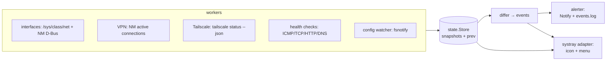

# NetPulse — Design Spec

Date: 2026-10-16
Status: approved design, pre-implementation
Source requirements: `docs/specs.md`

## 1. Overview

NetPulse is a single-process Go utility that monitors network interfaces,
VPN connections, Tailscale, and user-defined health-check targets. It exposes
state through a StatusNotifierItem tray icon and menu, and emits transition
notifications plus an optional event log.

Decisions locked during brainstorming:

- **Language**: Go.
- **UI**: tray icon + D-Bus menu only (`fyne.io/systray`). No GTK window in v1;
  the monitor core stays UI-agnostic so a window can be added later without
  restructuring.
- **Tailscale detail**: status line plus a peer submenu (hostname, Tailscale
  IP, online/offline, exit-node flag).
- **Alerts**: transition-based — one notification when a check crosses its
  failure threshold, one on recovery. Same for VPN drop, Tailscale
  disconnect, and route loss.
- **Architecture**: single process, ticker-driven workers writing into a
  central `state.Store`; a differ produces events; adapters (tray, alerter)
  consume. No daemon/client split, no event bus.

## 2. Architecture



Each worker owns one concern and publishes a snapshot struct on each tick.
`state.Store` keeps latest + previous snapshots; `Diff()` emits typed events
(`VpnDropped`, `TailscaleLost`, `RouteMissing`, `CheckDown`, `CheckUp`,
`ConfigReloaded`). Adapters never talk to workers directly.

## 3. Package layout

- `cmd/netpulse/main.go` — wire workers, store, differ, adapters; signal
  handling; nothing else.
- `internal/config` — TOML load/save-defaults; `fsnotify` watcher emitting
  reload events; keeps last-good config on parse error.
- `internal/sysnet` — interface list, up/down, MTU, IPv4/IPv6 addresses,
  byte counters from `/sys/class/net/*/statistics`; throughput computed from
  counter deltas; default-route presence.
- `internal/vpn` — NetworkManager `org.freedesktop.NetworkManager` via
  `godbus/dbus`: active connections filtered to type `vpn`/`tun`;
  `StateChanged` signal subscription with a 5s poll fallback.
- `internal/tailscale` — runs `tailscale status --json`, parses state,
  self IPs, peer list (hostname, IP, online, exit-node), exit node in use.
- `internal/health` — per-check probe scheduler; probe implementations
  behind a `Probe` func interface:
  - `icmp`: `go-ping` unprivileged datagram socket (Fedora default allows it).
  - `tcp`: `net.DialTimeout`.
  - `http`: `net/http` GET, 2xx/3xx = ok.
  - `dns`: `net.Resolver` against system resolvers or configured servers.
- `internal/state` — `Store` (mutex-guarded snapshots), `Diff() []Event`.
- `internal/alert` — `org.freedesktop.Notifications` Notify; append-only
  event log at `~/.local/state/netpulse/events.log` when `log_events`.
- `internal/tray` — `fyne.io/systray` SNI icon + `com.canonical.dbusmenu`
  menu; full menu rebuild on state change; three-state icon
  (ok / degraded / down); falls back to notifications-only when the menu
  service is unavailable.

## 4. Configuration

Path: `~/.config/netpulse/netpulse.toml`. Watched with `fsnotify`; reloads
without restart. Written with defaults + comments on first run if absent.
Invalid TOML on reload → keep last-good config, send one notification.

```toml
[general]
iface_interval_secs = 1
tailscale_interval_secs = 5
log_events = true
# Route prefixes that must stay present — alert if any disappear.
# Default route presence is always monitored; add internal nets here.
routes = []

[dns]
# Defaults for type="dns" checks: names to resolve and which servers.
targets = ["one.one.one.one"]   # FQDNs to resolve
servers = []                    # empty = system resolver

[[check]]
name = "router"
type = "icmp"                   # icmp | tcp | http | dns
target = "192.168.1.1"
interval_secs = 10
timeout_secs = 3
failures = 2                    # consecutive misses before "down"
critical = true                 # false = amber-only, never red icon

[[check]]
name = "corp vpn endpoint"
type = "tcp"
target = "10.0.0.5:443"
interval_secs = 15
```
Omitted fields take defaults: `interval_secs` 10, `timeout_secs` 3,
`failures` 2, `critical` true. A `type = "dns"` check resolves each name
in `dns.targets` via `dns.servers` (or the system resolver when empty);
`target` is ignored for that type.


## 5. Tray surface

Three-state icon: green (all monitored items ok), amber (degraded — a
non-critical check down, or a source `unavailable`), red (a breakage:
VPN dropped, Tailscale disconnected, a watched or default route missing,
or a `critical` check down).

Menu rebuilt on each state change:

```
NetPulse
enp1s0 ▸  192.168.1.20   ↓1.2MB/s ↑80KB/s
tailscale0 ▸ 100.64.1.5  ↓0 ↑0
──────────
VPN: nm-connection "corp" — active
Tailscale: connected · exit: homelab ▸
    peer "nas" 100.64.1.10 (online)
    peer "laptop" 100.64.1.12 (offline)
──────────
Checks ▸
    router — ok (4ms)
    corp vpn endpoint — DOWN
──────────
Reload config      Quit
```

## 6. Workers and intervals

| Worker | Source | Default cadence |
|---|---|---|
| Interfaces | `/sys/class/net` + sysfs statistics | 1s tick |
| VPN | NM D-Bus `StateChanged` signal | event + 5s poll fallback |
| Routes | `ip -j route` (parse JSON) or netlink if parsing proves fragile | 5s tick |
| Tailscale | `tailscale status --json` | 5s tick |
| Health checks | per-check | per-check `interval_secs` |
| Config | fsnotify | event |

## 7. Error handling

- **NetworkManager unreachable** (name dropped from bus): VPN source marked
  `unavailable`; interface tracking continues via sysfs; re-attach on
  `NameOwnerChanged`.
- **`tailscale` binary missing / `tailscaled` stopped**: Tailscale source
  reports `unavailable`/`stopped` — a distinct menu state, not a check
  failure. JSON parse error → keep last-good snapshot, log to stderr.
- **Health checks**: the failure counter increments only on completed probes
  that fail; internal worker errors never count as target failures.
  Recovery: a single success after `down`.
- **D-Bus menu unavailable**: run notifications-only, warn on stderr.
- **Worker panic**: recovered at the worker goroutine boundary, source marked
  unavailable, event logged.

## 8. Testing

- `internal/state`: differ unit tests — transition table (ok→down, down→ok,
  unavailable handling).
- `internal/health`: failure-threshold counting with fake `Probe` funcs; no
  real sockets.
- `internal/tailscale`: golden `status --json` fixtures (connected, stopped,
  exit-node variants) → parse tests.
- `internal/config`: TOML fixtures, default-write, reload on change,
  last-good retention on bad TOML.
- `internal/sysnet`: counter-delta throughput math on fixture stat files.
- Smoke: `go build`, run against the real session bus, verify menu + one
  notification path manually. No dbusmock, no systray harness — logic lives
  below the adapters.

## 9. Dependencies

| Dep | Purpose |
|---|---|
| `github.com/godbus/dbus/v5` | NetworkManager, Notifications, dbusmenu |
| `fyne.io/systray` | StatusNotifierItem tray + menu |
| `github.com/go-ping/ping` | unprivileged ICMP |
| `github.com/fsnotify/fsnotify` | config watch |
| `github.com/BurntSushi/toml` | config parsing |

No GUI toolkit, no netlink library, no database. Static-friendly binary;
Fedora packaging is a single `%gobuild`-style spec.

## 10. Non-goals (carried from requirements)

No packet capture, no multi-machine view, no cloud sync, no GTK window in
v1, no privileged daemon — user-level process plus unprivileged ICMP only.
